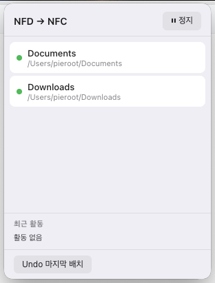
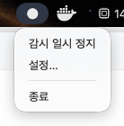
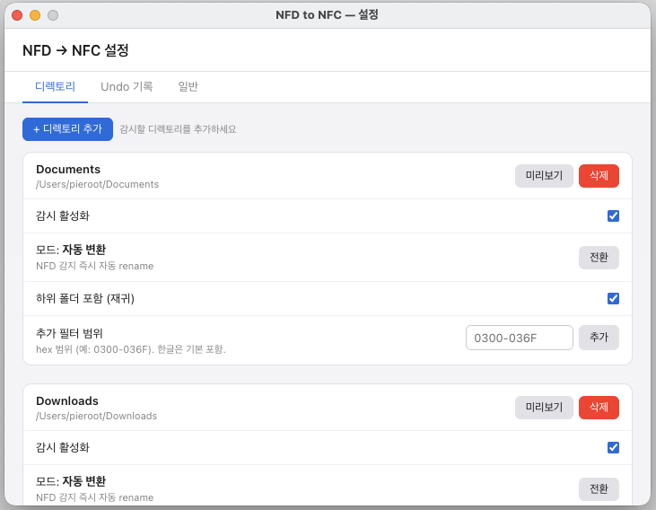
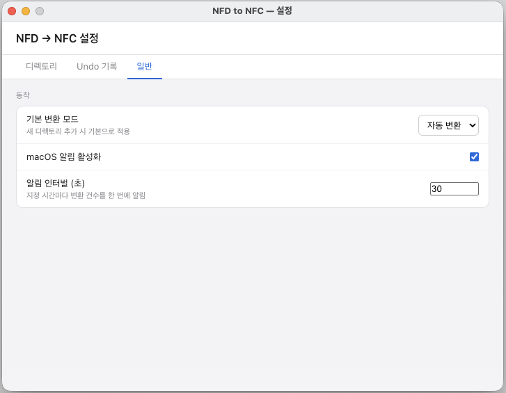

# NFD to NFC Normalizer

macOS에서 한글 파일명이 NFD(자모 분해)로 저장되는 문제를 실시간으로 해결하는 트레이 앱 + CLI + Node.js 라이브러리 통합 패키지입니다.

> **웹 버전**: 설치 없이 [웹 변환기](https://nfd2nfc.com/)에서 ZIP·파일·폴더를 선택하거나 끌어다 놓으면 한글 파일명을 정리한 ZIP을 받을 수 있습니다. 변환 코드는 파일을 서버로 전송하지 않습니다.

> **Breaking Change (2.0.0)**: 단일 패키지 구조로 통합됐습니다. `MACOS-APP/`, `nfd2nfc/` 서브 패키지 구조는 제거됐습니다. CLI 명령이 `nfd2nfc file <path>` / `nfd2nfc dir <path>` 형태로 변경됐습니다.

## 주요 기능

- **실시간 감시**: 선택한 디렉토리를 chokidar로 감시하여 파일이 생기는 즉시 NFC로 자동 변환
- **트레이 팝오버**: macOS 메뉴바에 상주, 좌클릭으로 300×400 팝오버 표시
- **설정창**: 3탭 설정 화면 (감시 디렉토리 / Undo 기록 / 일반)
- **Auto / Manual 모드**: Auto는 즉시 변환, Manual은 큐에 누적 후 직접 적용
- **Undo 시스템**: 마지막 5초 배치 또는 개별 변환 되돌리기
- **알림 배치**: 30초 간격으로 변환 건수를 묶어 알림 — 알림 폭주 방지
- **APFS 정확 처리**: 같은 inode 비교로 normalization-insensitive 파일 시스템 올바르게 처리
- **한글 자모 필터**: U+1100-11FF, U+A960-A97F, U+D7B0-D7FF 영역만 대상 (라틴 NFD는 무시)

## 설치

### macOS 애플리케이션

[릴리즈 페이지](https://github.com/jung-geun/NFD2NFC/releases)에서 `NFD2NFC-arm64.dmg` 또는 `NFD2NFC-x64.dmg`를 다운로드하거나 직접 빌드합니다.

### CLI (소스에서 글로벌 설치)

Git·Node.js·npm이 필요합니다. GitHub 소스를 받아 CLI를 빌드한 뒤 설치합니다.

```bash
git clone https://github.com/jung-geun/NFD2NFC.git
cd NFD2NFC
npm install
npm run build:cli
npm install -g .
```

설치 후 `nfd2nfc --help`로 명령을 확인할 수 있습니다. CLI는 원본 파일명을 직접 변경하므로 `nfd2nfc dir "./my-folder" --recursive --dry-run`으로 대상을 확인한 뒤 `--dry-run`을 빼고 실행하세요.

### Node.js 라이브러리

위에서 받은 소스 디렉토리에서 라이브러리를 빌드한 뒤, 사용할 Node.js 프로젝트에서 해당 디렉토리를 설치합니다.

```bash
# NFD2NFC 소스 디렉토리에서
npm run build:lib

# 사용할 Node.js 프로젝트에서 (경로를 실제 소스 위치로 바꾸세요)
npm install /absolute/path/to/NFD2NFC
```

## 사용법

### 웹 변환기

1. **ZIP·파일 선택** 또는 **폴더 선택**을 누르거나 파일·폴더를 드롭합니다. 업로드 영역은 처리 중·완료 후에도 유지되어 계속 추가할 수 있습니다. 일반 파일과 ZIP은 각각 별도 변환하고, 폴더는 내부 경로를 유지한 ZIP 하나로 묶습니다. 같은 파일을 다시 선택해도 새 항목으로 추가됩니다. 폴더 선택을 지원하지 않는 브라우저에서도 일반 파일 선택은 사용할 수 있습니다.
2. 추가한 순서대로 **파일 읽기 / ZIP 해제 → 이름 분석 → ZIP 압축 → 링크 생성**을 진행합니다. 진행률은 해당 단계의 파일·ZIP 개수 또는 실제 읽은 바이트를 기준으로 하며, 인위적인 대기 시간은 없습니다. 한 항목이 실패해도 앞선 결과는 유지하고 다음 항목을 계속 처리합니다.
3. **변환 내역**에서 완료된 항목의 **ZIP 다운로드**를 각각 누릅니다. 결과별로 생성 시점부터 **5분**만 유지하며, 새 파일을 추가해도 앞선 결과의 만료 시각은 연장되지 않습니다. 만료되면 해당 항목의 임시 파일 참조·다운로드 URL만 해제하고 만료 상태를 표시합니다. **결과 삭제**는 선택한 결과만 제거하며, 페이지를 떠나면 모든 결과와 대기 항목을 정리합니다. 원본 파일은 변경하지 않습니다.

- 파일 선택은 **서버 업로드가 아닙니다**. 변환 코드는 File API로 기기 안에서 읽고 ZIP을 만들며, `localStorage`·`sessionStorage`·IndexedDB·OPFS·Cache API에 사용자 파일을 저장하지 않습니다. 운영 페이지의 Google AdSense 광고는 별도로 외부 통신·쿠키·기기 정보 등을 사용할 수 있고 페이지와 같은 실행 환경을 공유합니다. 따라서 CSP로 모든 네트워크 전송을 차단한다고 보장하지 않습니다. 외부 광고 스크립트 없이 민감한 파일을 처리하려면 로컬 CLI를 이용하세요.
- **각 변환 항목별로** 선택한 파일의 합계, ZIP 해제 후 파일의 합계, 생성 ZIP의 크기를 **각각 100MiB(104,857,600바이트)**로 제한합니다. 서로 다른 최상위 파일·ZIP·폴더는 별도 항목이며, 한 폴더 안의 파일·ZIP은 합산합니다. ZIP 해제 크기는 본문을 풀기 전에 검사합니다. ZIP 헤더도 출력 크기에 포함되므로 입력이 정확히 100MiB이면 결과는 제한을 넘을 수 있습니다. 더 큰 자료는 CLI·데스크톱 앱을 이용해주세요.
- 메모리 부담을 줄이기 위해 변환은 한 번에 하나씩 진행합니다. 백그라운드 탭에서 타이머가 중지되더라도 탭 복귀·포커스·페이지 복원·다운로드 클릭 시 항목별 만료 시각을 다시 검사합니다. 결과 삭제 시 Safari 다운로드 시작을 위해 URL 해제를 최대 1초 늦추며, 지연 해제 중인 URL도 페이지를 떠나면 즉시 해제합니다. 여러 결과의 실제 메모리 사용량과 회수 시점은 기기·브라우저에 따라 달라집니다. **사용자가 다운로드한 파일은 자동 삭제할 수 없습니다**.
- [GitHub Pages 공식 제한](https://docs.github.com/en/pages/getting-started-with-github-pages/github-pages-limits)은 게시 사이트 1GB, 월 전송량 100GB(soft limit)입니다. 변환 파일은 GitHub에 저장하거나 전송하지 않으므로 이 용량에 포함되지 않습니다. [브라우저 Web Storage](https://developer.mozilla.org/en-US/docs/Web/API/Storage_API/Storage_quotas_and_eviction_criteria#web_storage)의 origin당 `localStorage` 약 5MiB 제한은 서버 용량과 별개이며, 이 변환기는 파일 보관에 사용하지 않습니다.

- 선택한 ZIP과 폴더 안의 ZIP은 한 단계만 해제합니다. 내부 상대 경로를 원래 ZIP의 상위 폴더 아래에 유지하며, ZIP 안에 들어 있는 또 다른 ZIP은 파일 그대로 보관합니다. 빈 디렉토리는 결과에 포함하지 않습니다.
- 한글 NFD가 있는 경로만 NFC로 바꿉니다. 이름이 겹치면 `-2`, `-3` 등의 번호를 붙여 파일 내용을 덮어쓰지 않습니다. 이미 NFC인 이름과 한글 이외의 이름은 정규화하지 않습니다.
- ZIP 파일명은 UTF-8 플래그와 유효한 Unicode Path 메타데이터를 우선합니다. 인코딩 표시가 없는 이름은 UTF-8, 한국어 Windows CP949 순서로 읽습니다. 다른 구형 인코딩은 UTF-8 ZIP으로 다시 저장한 뒤 선택해주세요.
- ZIP 입력은 STORE·DEFLATE 및 ZIP64를 지원하며, ZIP64 정보 없이 정확히 65,535개 항목을 담은 일반 ZIP도 읽습니다. Windows식 경로 구분자를 처리하며, 경로 이탈·CRC 불일치·손상된 ZIP은 오류로 알립니다. 암호화·분할 ZIP·심볼릭 링크·다른 압축 방식은 지원하지 않습니다.
- 출력은 내용 재압축 없이 **STORE** 방식으로 묶고, 65,535개 이상의 항목에는 ZIP64를 사용합니다. 파일을 스트리밍으로 읽어 CRC를 계산하고 원본 Blob을 참조하므로 전체 출력 바이트를 JavaScript 배열에 쌓지 않습니다. DEFLATE 버퍼도 검사한 항목 크기로 제한하고 크기 불일치를 거부합니다. 100MiB 제한 안에서도 실제 처리 가능 여부는 기기의 메모리와 브라우저에 따라 달라집니다.
- 모바일·태블릿 레이아웃, 키보드 선택, 라이트·다크 테마, 시스템의 모션 감소 설정을 지원합니다. 완료·오류 상태는 텍스트로도 전달됩니다.

### macOS 애플리케이션

앱 실행 후 메뉴바 아이콘을 좌클릭하면 팝오버가 표시됩니다. 감시 중인 디렉토리 목록과 최근 활동, Undo 버튼을 한눈에 확인할 수 있습니다.



메뉴바 아이콘을 우클릭하면 감시 일시 정지, 설정창 열기, 종료 메뉴가 나옵니다.



설정창의 **디렉토리** 탭에서 감시할 디렉토리를 추가하고, 디렉토리별로 감시 활성화 여부 / Auto·Manual 모드 / 하위 폴더 포함 / 추가 필터 범위를 개별 설정할 수 있습니다. 추가된 디렉토리는 앱 재시작 시에도 유지됩니다.



**일반** 탭에서는 기본 변환 모드, macOS 알림 활성화, 알림 인터벌(초)을 설정합니다.



### CLI

```bash
# 디렉토리 변환 (재귀)
nfd2nfc dir <path> --recursive

# 미리보기 (실제 변환 없음)
nfd2nfc dir <path> --dry-run

# 단일 파일 변환
nfd2nfc file <path>

# 경로 자동 감지 (파일/디렉토리 판별 후 처리)
nfd2nfc <path>

# 도움말
nfd2nfc --help
```

### Node.js 라이브러리

```javascript
const nfd2nfc = require("@pieroot/nfd2nfc");

// v1 호환 — 단순 문자열 정규화
const nfc = nfd2nfc.normalizeToNFC("NFD로 인코딩된 문자열");
const nfd = nfd2nfc.normalizeToNFD("NFC로 인코딩된 문자열");

// v2 신규 — 파일 시스템 API
const { normalizeEntry, scan, shouldNormalize } = require("@pieroot/nfd2nfc");

// 단일 파일/디렉토리 rename (APFS inode 처리 포함)
const result = await normalizeEntry("/path/to/file", "file");
// result.status: 'renamed' | 'skipped' | 'noop-same-inode' | 'collision'

// 디렉토리 재귀 스캔 (깊이 역순 정렬)
const entries = await scan("/path/to/dir", true);
```

## 빌드

```bash
npm install

# 개발 모드
npm run dev

# 전체 빌드 (앱 + CLI + 라이브러리 + DMG)
npm run build

# 앱만 빌드
npm run build:app

# CLI만 빌드
npm run build:cli

# 웹 개발 / 배포용 정적 빌드
npm run web:dev
npm run web:build
npm run web:preview

# 웹 타입 검사 / 전체 회귀 테스트
npx tsc --noEmit --project web/tsconfig.json
npm test
```

## 웹 배포 · 광고 · 검색 노출

- 공개 주소는 **https://nfd2nfc.com/** 입니다. `web/public/CNAME`, canonical, Open Graph, JSON-LD, sitemap의 주소를 이 도메인에 맞춥니다. GitHub Pages의 Custom domain도 `nfd2nfc.com`인지 확인하세요.
- `npm run web:build`는 초기 변환 화면·웹 사용법·CLI 설치법·FAQ를 **정적 HTML로 미리 렌더링**합니다. 브라우저는 이를 hydrate해 기존 변환 기능을 이어받습니다. JavaScript를 실행하지 않는 크롤러도 소개와 사용법을 읽을 수 있습니다. 개발 서버는 클라이언트 렌더링을 사용합니다.
- 운영 빌드는 monolog과 같은 AdSense 게시자 `ca-pub-6070999186513755`의 자동 광고 코드를 한 번 로드합니다. `web/public/ads.txt`에 동일한 게시자를 선언합니다. 수동 슬롯 ID나 빈 광고 박스는 사용하지 않습니다. 개발 서버에는 광고 코드를 넣지 않습니다.
- monolog과 같이 `data-overlays="bottom"`으로 앵커 광고를 하단에 고정합니다. 이 속성은 AdSense의 앵커 위치 설정을 덮어쓰며, 계정에서 앵커 광고를 꺼도 활성화할 수 있습니다. 앵커 광고를 끄려면 로더의 이 속성을 제거한 뒤 계정 설정을 사용하세요. [공식 앵커 동작 안내](https://support.google.com/adsense/answer/7478225)
- AdSense에서 **nfd2nfc.com 등록·승인과 Auto ads 활성화**를 확인하세요. 변환 조작을 방해하지 않도록 광고 미리보기에서 `#converter` 영역을 제외하는 설정을 권장합니다. 실제 광고 위치·빈도·게재 여부는 Google이 결정하며 코드만으로 보장하지 않습니다. [Auto ads 설정](https://support.google.com/adsense/answer/9261307)
- CSP는 `form-action 'none'`, `object-src 'none'`, `base-uri 'self'`, `worker-src 'self' blob:`를 유지합니다. 광고 통신을 막던 `connect-src 'none'` 등 리소스 제한은 제거했습니다. 정적 Pages에서 고정 nonce를 만들거나, 변경되는 Google 광고 도메인을 고정 목록으로 제한하지 않습니다. [AdSense CSP 공식 안내](https://support.google.com/adsense/answer/16283098)
- 페이지 하단에 개인정보·광고 처리 안내를 제공합니다. EEA·영국·스위스 사용자에게 개인 맞춤 광고를 제공하려면 AdSense의 개인정보 보호 및 메시지에서 Google 인증 CMP와 IAB TCF 통합 등 적용되는 동의 요건을 설정해야 합니다. [Google 동의 관리 요건](https://support.google.com/adsense/answer/13554116)
- SEO/AEO는 설명적인 한국어 제목·본문, 질문별 답변, 정확한 `WebSite`/`WebApplication` 구조화 데이터, 크롤링 허용, canonical과 sitemap으로 대응합니다. 존재하지 않는 평점·리뷰·FAQ 리치 결과를 꾸미거나 별도 AI 전용 파일을 추가하지 않습니다. [Google AI 검색 가이드](https://developers.google.com/search/docs/appearance/ai-features), [OpenAI 검색 크롤러 안내](https://developers.openai.com/api/docs/bots)
- 배포 후 Google Search Console·Bing Webmaster Tools·네이버 서치어드바이저에서 새 도메인의 소유권을 확인하고 **https://nfd2nfc.com/sitemap.xml**을 제출하세요. 인증값은 임의로 생성하지 않습니다. 이전 도메인을 운영하는 호스팅/DNS 제공자에서 새 도메인으로 301/308 리다이렉트를 설정하고, 해당되는 경우 Search Console 주소 변경도 제출하세요. CNAME 파일만으로 이전 별도 호스트의 리다이렉트를 설정할 수는 없습니다. [도메인 이전 공식 안내](https://developers.google.com/search/docs/crawling-indexing/site-move-with-url-changes)
- 메타데이터·sitemap·크롤링 허용은 검색 순위, 색인, AI 답변 인용을 보장하지 않습니다.

## 기여

이 프로젝트에 기여하려면 다음 단계를 따르세요:

1. 이 저장소를 포크합니다.
2. 새로운 브랜치를 만듭니다: `git checkout -b feat/new-feature`
3. 변경 사항을 커밋합니다: `git commit -am 'Add new feature'`
4. 브랜치에 푸시합니다: `git push origin feat/new-feature`
5. PR을 만듭니다.

## 라이선스

이 프로젝트는 MIT 라이선스를 사용합니다.
